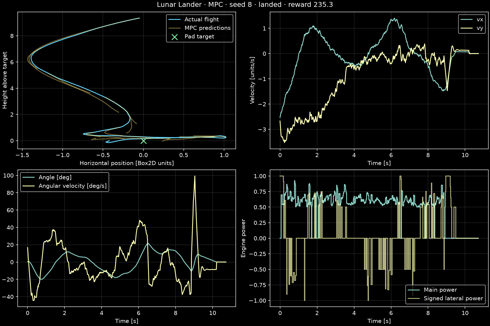
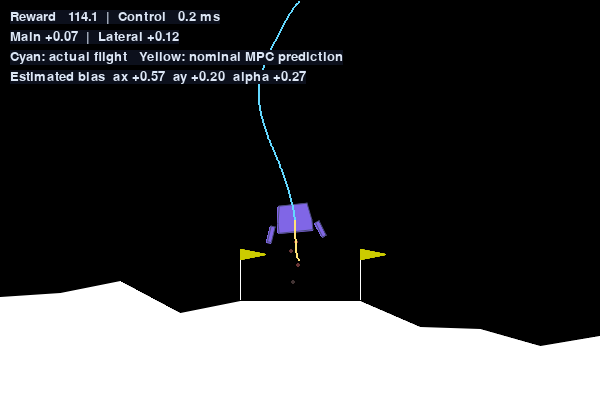
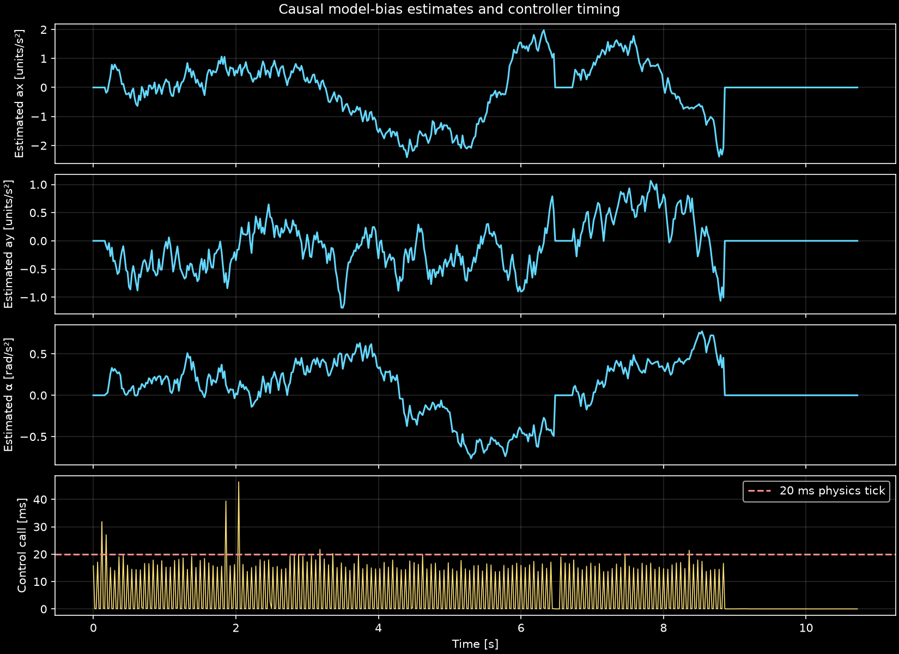

# Lunar Lander · Model Predictive Control

[](https://github.com/CagriCatik/Lunar-Lander/actions/workflows/ci.yml)


**Land a rocket by predicting its flight and optimising its engine commands. No training required.**

A sampling-based MPC controller for the continuous-action version of Gymnasium's
`LunarLander-v3`. Watch the actual and predicted trajectories together, inspect engine
commands, and compare the disturbance-aware controller against the original MPC.
Version **0.2** adds a causal disturbance observer, five acceleration scenarios,
active touchdown stabilisation and a smaller planning budget.

On 50 new moderate-wind seeds, v0.2 landed **47/50**, compared with **28/50** for the
original MPC. The no-wind regression remained **50/50**. See the
[full benchmark and stress-test limits](docs/robustness.md).



## Quick start

macOS or Linux, with **Python 3.11, 3.12 or 3.13**:

```bash
git clone https://github.com/CagriCatik/Lunar-Lander.git
cd Lunar-Lander
./scripts/setup.sh --dev
./scripts/run.sh --render
```

The setup script creates `.venv`, installs SWIG before Box2D, installs the project,
and checks that the environment can reset and step. It does not require activation,
global Python package installation, or changes to your shell profile.

Choose a specific interpreter if your default Python is outside the supported range:

```bash
PYTHON_BIN=python3.13 ./scripts/setup.sh --dev
```

The window shows a **cyan flight trail**, **yellow nominal prediction**, reward and
control timing. Close the window or press **Escape** to stop and save the episode.



## Run and compare

```bash
# Interactive MPC, different initial push and terrain
./scripts/run.sh --render --seed 7

# Headless run with saved plot and telemetry
./scripts/run.sh --seed 0

# Matched-environment, matched-seed wind comparison against v0.1
./scripts/evaluate.sh --config configs/wind.toml --episodes 50 --seed 50 --output runs/mpc-wind
./scripts/evaluate.sh --controller nominal --config configs/v1-wind.toml --episodes 50 --seed 50 --output runs/original-wind

# Disturbance stress scenario
./scripts/run.sh --render --config configs/wind.toml --seed 3

# Stronger gusts; failures remain possible
./scripts/run.sh --render --config configs/strong-wind.toml --seed 101

# Repeatable matrix: wind, no wind, original MPC, stronger gusts and changed gravity
./scripts/benchmark.sh --episodes 20 --seed 50
# Or just the matched wind comparison
./scripts/benchmark.sh --scenarios wind nominal-wind --episodes 50 --seed 50
# Add --profile for a sequential fixed-state planning-time comparison

# Development checks
./scripts/doctor.sh
./scripts/test.sh -q
```

Every run uses a new timestamped output directory unless `--output` is supplied.
Existing results are never overwritten. Use `--no-plot` to skip PNG generation.

You can also activate the environment and use the installed command:

```bash
source .venv/bin/activate
lunar-mpc run --render --config configs/default.toml
lunar-mpc evaluate --episodes 20 --controller mpc
```

## Configure locally

Copy the default configuration and pass it to either entry point:

```bash
cp configs/default.toml configs/local.toml
./scripts/run.sh --render --config configs/local.toml
```

| Setting | Default | Effect |
|---|---:|---|
| `environment.gravity` | `-10.0` | Vertical acceleration; the nominal model uses the same value |
| `environment.wind` | `false` | Enable simulator wind and rotational turbulence |
| `environment.wind_power` | `10.0` | Simulator wind-force magnitude |
| `environment.turbulence_power` | `0.5` | Simulator wind-torque magnitude |
| `environment.max_steps` | `1000` | Episode time limit, at 50 physics steps per second |
| `mpc.horizon` | `20` | Number of prediction intervals |
| `mpc.dt` | `0.06` | Seconds per prediction interval; multiple of `0.02` |
| `mpc.knots` | `5` | Piecewise-constant control-bias segments |
| `mpc.samples` | `64` | Candidate sequences per CEM iteration |
| `mpc.elites` | `8` | Best candidates used to update the search distribution |
| `mpc.iterations` | `2` | CEM refinements per optimisation |
| `mpc.replan_interval` | `3` | Simulator steps between optimisations |
| `mpc.noise` | `0.4` | Initial search standard deviation |
| `mpc.min_std` | `0.08` | Minimum search standard deviation |
| `robust.observer_tau` | `0.18` | Horizontal/angular estimation time constant [s]; vertical uses twice this |
| `robust.warmup_steps` | `8` | Ignore initial transition residuals while the legs settle |
| `robust.max_linear_accel` | `6.0` | Bound on each estimated linear acceleration bias [units/s²] |
| `robust.max_angular_accel` | `3.0` | Bound on estimated angular acceleration bias [rad/s²] |
| `robust.wind_margin` | `0.4` | Horizontal acceleration scenario offset [units/s²] |
| `robust.torque_margin` | `0.15` | Angular acceleration scenario offset [rad/s²] |
| `robust.risk_weight` | `0.5` | Blend from mean scenario cost (0) to worst sampled cost (1) |

The defaults look **1.2 seconds ahead** and replan every **0.06 simulated seconds**.
Feedback is recomputed at every physics step between replans. Larger sample counts,
horizons and iteration counts increase computation. Invalid and misspelled settings
fail explicitly. This is a CPU implementation; no CUDA or GPU setup is needed.

## What the controller does

1. Convert Gymnasium's observation into six physical flight states.
2. Compare the measured transition with the previous nominal prediction and filter the acceleration error.
3. Compensate feedback for estimated horizontal force, vertical force and rotational disturbance.
4. Sample control-bias sequences and test each against five acceleration hypotheses.
5. Rank trajectories by a blend of mean and worst sampled tracking/fuel/safety cost, then refine CEM.
6. Apply the first optimised bias; stabilise attitude separately when a leg contacts the ground.

The zero-bias feedback trajectory remains a candidate at every optimisation. The
selected plan therefore has no higher **predicted cost** than that proposal, although
model error means this does not guarantee a better real trajectory. The prediction
curve shows the central disturbance estimate, not a guaranteed uncertainty envelope.
On contact, the main engine switches off; lateral jets level a tilted lander and
then release it to settle. Contact impulses are excluded from disturbance estimation.

This is **feedback-shooting MPC** with a disturbance observer. The controller sees
only observations and its past actions; it cannot read the simulator's wind state.
`--controller nominal` retains the original MPC and contact policy; use
`configs/v1-wind.toml` to reproduce its original solver budget. `--controller feedback`
retains the original feedback-only baseline without the new observer or scenarios.
See [controller and model details](docs/controller.md) for equations, costs and boundaries.

## Results and diagnostics

Each episode produces:

| File | Contents |
|---|---|
| `flight.png` | Flight path, sampled prediction snapshots, velocity, attitude and engine power |
| `diagnostics.png` | Estimated acceleration biases and controller latency |
| `telemetry.csv` | State, contacts, actions, effective power, latency and three estimated biases |
| `predictions.json` | Nominal predicted state trajectories, indexed by simulator step |
| `summary.json` | Outcome, reward, first-contact approach motion, final state, fuel proxy and timing |
| `config.json` | Effective settings, including defaults |
| `runtime.json` | Python, platform, environment ID and simulator/package versions |
| `evaluation.json` | Aggregate results and per-episode summaries |
| `benchmark.json` | Completed scenarios when using the robustness matrix script |

`landed` means the simulation terminated at rest on the pad with leg contact and
without a body crash. `score_at_least_200` is tracked separately. Contact velocity
is sampled **before the first contact step**, so it is an approach-speed estimate,
not an exact time-of-impact measurement. Fuel is infinite in this environment;
the reported fuel proxy integrates effective main and lateral power, not kilograms.

See the [v0.2 robustness benchmark](docs/robustness.md) for matched comparisons and
stress-test failures. The [v0.1 reference](docs/benchmark.md) is preserved separately.



## Project structure

| Module | Responsibility |
|---|---|
| `config.py` | TOML loading and validation |
| `model.py` | State conversion, engine thresholds, vectorised flight prediction |
| `guidance.py` | Landing targets and stabilising feedback proposal |
| `controller.py` | Shared CEM search and original nominal controller |
| `observer.py` | Bounded causal estimation from transition errors |
| `robust.py` | Disturbance compensation, scenario rollout and touchdown stabilisation |
| `environment.py` | Gymnasium construction and outcome classification |
| `runner.py` | Episodes, metrics and artifact writing |
| `visualization.py` / `plotting.py` | Live overlay / saved headless plots |
| `cli.py` | Local run and evaluation commands |
| `benchmark.py` | Matched-environment robustness matrix |

The model, guidance and optimiser do not import Gymnasium or access simulator
internals. Only the adapter, outcome classifier and live overlay use Box2D-specific
details. Tests cover engine boundaries, state scales, vectorisation, reproducibility,
configuration failures, nominal-model mismatch, timeout reporting and an actual landing.
CI runs on Linux and macOS with Python 3.11–3.13.

## Limits and troubleshooting

- The flight model approximates the articulated vehicle as a rigid body. It omits
  random exhaust dispersion, terrain geometry and ground contacts. The adaptive
  controller adds estimated acceleration biases; it does not know future gusts.
- Attitude, ground and viewport penalties are **soft costs**. Only action bounds and
  engine activation rules are enforced directly. This is not a safety-certified or
  controller with a formal robust-invariance or collision-avoidance guarantee.
- Real-time execution is hardware-dependent. Planning calls can exceed one 20 ms
  physics tick; summaries report planning latency and the fraction of control calls
  above 20 ms. The simulator may run slower than wall-clock real time.
- A new seed changes terrain and the initial push. Equal seeds reproduce runs on a
  matching software/platform stack; cross-platform bitwise identity is not promised.
- If Box2D must compile, install a C++ compiler: `xcode-select --install` on macOS,
  or `sudo apt install build-essential python3-dev python3-venv` on Ubuntu/Debian.
- If `python3 -m venv` fails on Ubuntu/Debian, install `python3-venv` first.
- On a server without a display, omit `--render`. Plots work headlessly.
- Native Windows shell setup is not provided. Use Linux/WSL, or install manually
  in a Python virtual environment with SWIG before `pip install -e '.[dev]'`.
- Scripts accept `VENV_DIR` for a custom virtual environment; supply the same value
  to setup and subsequent commands.

## References

- [Gymnasium Lunar Lander documentation](https://gymnasium.farama.org/environments/box2d/lunar_lander/)
- [Pinned Gymnasium 1.2.3 implementation](https://github.com/Farama-Foundation/Gymnasium/blob/v1.2.3/gymnasium/envs/box2d/lunar_lander.py)

Gymnasium and Box2D remain their respective authors' projects. This repository adds
the predictive controller, local workflow and evaluation tooling.
